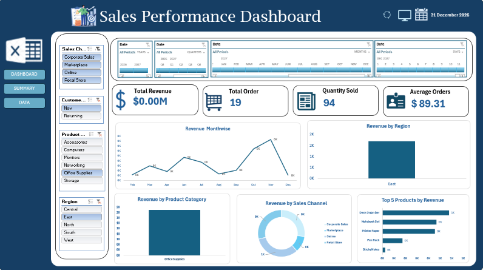

# Retail Sales Performance Dashboard (Excel)

An interactive Excel-based business intelligence dashboard designed to monitor retail sales performance, analyze revenue drivers, and track order trends across channels, regions, and customer segments.

---

## Dashboard Overview



---

## Executive Summary & Core KPIs

The dashboard summarizes **2,000 unique orders** across 15 salespeople, 28 products, and 5 geographic regions:

- **Total Revenue:** **$3.46M** *(Net sales generated)*
- **Total Orders:** **2,000** *(Order volume)*
- **Total Quantity Sold:** **7,552 units**
- **Average Order Value (AOV):** **$1,731.30**

---

## Key Features & Visualizations

1. **Dynamic Interactive Slicers:**
   - **Timeline Filter:** Multi-level date filtering across Years, Quarters, Months, and Days.
   - **Categorical Slicers:** Filter by **Sales Channel** (*Corporate, Marketplace, Online, Retail Store*), **Customer Type** (*New vs. Returning*), **Product Category**, and **Region**.

2. **Performance Visuals:**
   - **Revenue Monthwise:** Trend line chart tracking monthly sales trajectory and seasonal fluctuations.
   - **Revenue by Region:** Bar chart highlighting sales performance across Central, East, North, South, and West regions.
   - **Revenue by Product Category:** Volume and value contribution across 6 categories (Office Supplies, Computers, Accessories, Monitors, Networking, Storage).
   - **Revenue by Sales Channel:** Donut chart evaluating channel effectiveness.
   - **Top 5 Products by Revenue:** Ranked bar chart showcasing highest-grossing products (Desk Organizer, Notebook Set, Printer Paper, etc.).

---

## Workbook Structure

- `assets/dashboard_screenshot.png` - Visual preview of the Excel dashboard
- `Data (2).xlsx` - Complete Excel workbook containing:
  - **Dashboard:** Interactive reporting interface with linked PivotCharts & slicers
  - **Summary:** PivotTable aggregations by dimension
  - **Detail1:** Granular drill-down tables
  - **Data:** Cleaned raw order transactions (2,000 rows)
- `README.md` - Project documentation and overview

---

## Tech Stack

- **Platform:** Microsoft Excel
- **Techniques:** PivotTables, PivotCharts, Timeline Controls, Dynamic Slicers, KPI Card Design, Data Modeling

---

## How to Use

1. Clone or download the repository:
   ```bash
   git clone https://github.com/Apurva16032005/Sales_Dashboard_Excel.git
   ```
2. Open `Data (2).xlsx` in **Microsoft Excel**.
3. Navigate to the **Dashboard** sheet and use the left-hand slicers or timeline controls at the top to dynamically explore the metrics.
